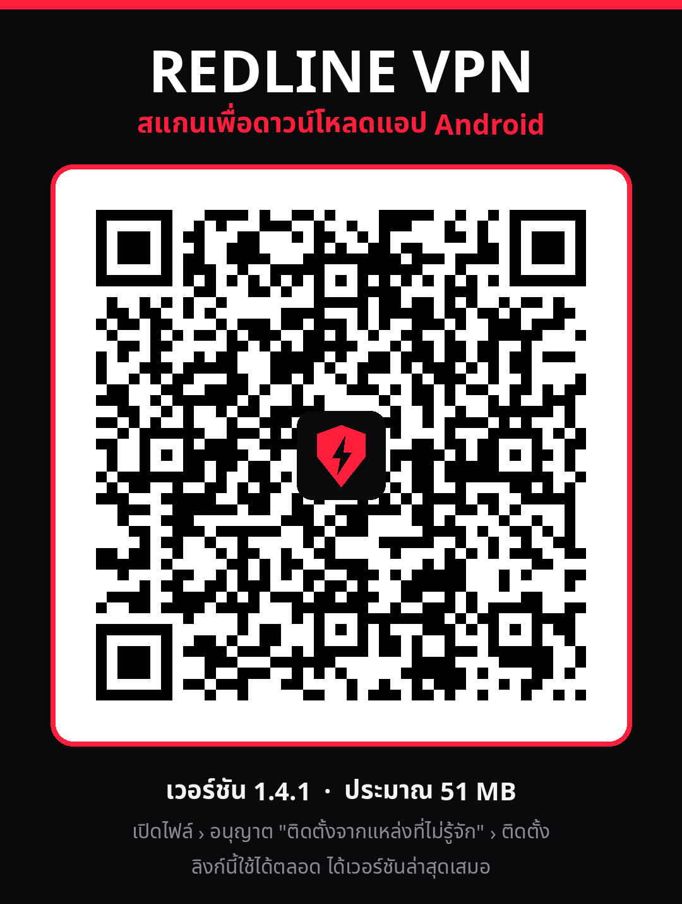

# REDLINE VPN (Android)

แอป VPN ธีมดำ-แดง เขียนด้วย Kotlin + Jetpack Compose ทุกฟีเจอร์ปลดล็อกในตัว ไม่มีแพ็กเกจหรือโฆษณา

## ฟีเจอร์

| ฟีเจอร์ | ทำงานอย่างไร |
|---|---|
| **Shield + Turbo** | VPN ภายในเครื่อง (ไม่ต้องมีเซิร์ฟเวอร์): บล็อกโฆษณา / ตัวติดตาม / มัลแวร์ด้วยการกรอง DNS, เลือก DNS ที่ตอบเร็วที่สุด + แคช DNS บนเครื่อง |
| **Secure VPN** | อุโมงค์ WireGuard แบบเข้ารหัสทั้งเครื่อง ใช้ไฟล์ `.conf` จากผู้ให้บริการ VPN ของคุณหรือเซิร์ฟเวอร์ส่วนตัว นำเข้าได้หลายประเทศ วัดปิงได้ และเลือกเซิร์ฟเวอร์ที่เร็วที่สุดให้อัตโนมัติ |
| **บล็อกโฆษณา** | มีรายการในตัวราว 120 โดเมน อัปเดตเป็นชุดเต็มของ StevenBlack (~150k) ได้จากในแอป เมื่อใช้โหมด WireGuard จะใช้ AdGuard DNS แทน |
| **Split Tunneling** | เลือกแอปที่ไม่ต้องผ่าน VPN |
| **Kill Switch** | ใช้ Always-on VPN + "Block connections without VPN" ของ Android |
| **เบราว์เซอร์ส่วนตัว** | บล็อกโฆษณาและป๊อปอัป ไม่เก็บประวัติหรือคุกกี้ และตรวจจับสตรีมวิดีโอ (m3u8/mp4) บนหน้าเว็บเพื่อเปิดในเพลเยอร์หรือส่งไปทีวี |
| **REDLINE Player** | ExoPlayer รองรับ HLS/DASH/MP4 ใช้บัฟเฟอร์ 2 นาที เลือกความคมชัดได้ ปรับความเร็วได้ และมี PiP |
| **สำรวจ 18+** | ค้นหาครั้งเดียวจาก Eporner, RedTube และ Pornhub ผ่าน API สาธารณะของแต่ละเว็บ ได้ผลเป็นคลิปพร้อมเล่นทันที (เล่นผ่าน embed player ไม่ต้องเข้าหน้าเว็บ บล็อกโฆษณา) เรียงตามยอดนิยม/ใหม่/เรตติ้ง/ความยาว เลื่อนโหลดต่อได้ไม่สิ้นสุด แปลชื่อคลิปเป็นไทยได้ ดาวน์โหลด แคสต์ทีวี และดูพร้อมซับไทยได้ มีหน้ายืนยันอายุ 18+ และล็อกด้วยลายนิ้วมือ/PIN ได้ ระบบกรองคำค้นและผลลัพธ์ที่เกี่ยวกับผู้เยาว์หรือการไม่ยินยอมไว้ตายตัว ปิดไม่ได้ |
| **ดาวน์โหลด / บันทึก / แชร์** | ปุ่มดาวน์โหลดในเบราว์เซอร์ เพลเยอร์ และหน้ามีเดีย รองรับ MP4/WEBM/MKV และ HLS (m3u8) รวมถึง HLS ที่เข้ารหัส AES-128 แบบมาตรฐาน ส่ง Referer/Cookie ของหน้าเว็บไปด้วย ลองใหม่อัตโนมัติ ดาวน์โหลดต่อเมื่อเน็ตหลุด และทำงานเบื้องหลังได้ ไฟล์บันทึกที่ Movies/REDLINE แชร์ได้ทั้งไฟล์และลิงก์ |
| **ซับไทยอัตโนมัติ** | แปลซับในคลิป (หรือไฟล์ SRT/VTT/ASS) จากภาษาใดก็ได้เป็นไทยแบบเรียลไทม์ ด้วย ML Kit บนเครื่อง |
| **แปลเสียงเป็นไทย (AI)** | ใช้ [whisper.cpp](https://github.com/ggml-org/whisper.cpp) v1.7.6 (`third_party/whisper.cpp`) ฟังเสียงพูดในคลิป ตรวจภาษาอัตโนมัติ 99 ภาษา แล้วแปลเป็นไทยด้วย ML Kit ทั้งหมดบนเครื่อง มี 2 โหมด: **แปลสด** ใช้ได้กับทุกคลิปรวมถึงสตรีม ซับขึ้นช้ากว่าเสียงประมาณ 5-8 วินาที และ **แปลทั้งคลิปล่วงหน้า** สำหรับไฟล์ในเครื่องหรือลิงก์ MP4 ซับตรงเวลา โมเดล Tiny/Base/Small (31/57/181 MB) ดาวน์โหลดครั้งแรกจาก Hugging Face |
| **แคสต์ Samsung TV** | ค้นหาทีวีด้วย DLNA/UPnP ใน Wi-Fi เดียวกัน แล้วส่งวิดีโอไปเล่น หรือใช้ Smart View |
| **Speed Test** | ทดสอบปิง ดาวน์โหลด และอัปโหลดกับ Cloudflare |

## ข้อจำกัดที่ควรรู้

- **ตัวเร่งเน็ต**: ไม่มีแอปไหนทำให้แพ็กเกจเน็ตเร็วเกินจริงได้ สิ่งที่แอปนี้ทำได้จริงคือเลือก DNS ที่เร็วที่สุด, แคช DNS, ตัดโฆษณาเพื่อลดข้อมูลที่ต้องโหลด และใช้บัฟเฟอร์ใหญ่ขึ้นตอนสตรีม
- **การแปลเสียง**: ต้องใช้มือถือ ARM 64-bit (เกือบทุกรุ่นตั้งแต่ปี 2017) ความเร็วขึ้นกับสเปกเครื่อง เครื่องระดับกลางขึ้นไปแนะนำโมเดล Base
- **เซิร์ฟเวอร์ VPN**: แอปไม่ได้แถมเซิร์ฟเวอร์มาให้ ต้องใช้ไฟล์ WireGuard ของคุณเอง ส่วนโหมด Shield ใช้ได้ทันทีโดยไม่ต้องมีเซิร์ฟเวอร์
- **Private DNS**: ถ้าตั้ง Private DNS ของ Android เป็นชื่อโฮสต์ (เช่น dns.google) โหมด Shield จะกรองโฆษณาไม่ได้

- **ดาวน์โหลด**: คลิปที่ป้องกันด้วย DRM (Widevine/PlayReady/FairPlay เช่น Netflix, Disney+) บันทึกไม่ได้ ส่วน DASH ที่แยกไฟล์ภาพกับเสียงยังไม่รองรับ

- **สำรวจ 18+**: Pornhub ถูกบล็อกในไทย ต้องเปิดโหมด Secure VPN ที่เซิร์ฟเวอร์ต่างประเทศก่อน และถ้าเว็บเปลี่ยนรูปแบบ API ฝั่งนั้นอาจโหลดไม่ได้ (แอปจะแจ้งเป็นรายแหล่ง)

## ติดตั้ง



สแกน QR หรือเปิดลิงก์ https://github.com/Phudy/VPN/raw/claude/mobile-vpn-app-w9ewpi/release/REDLINE-VPN.apk (ลิงก์คงที่ ได้เวอร์ชันล่าสุดเสมอ)

1. ดาวน์โหลด APK จาก GitHub Actions (แท็บ Actions › Build APK › Artifacts) หรือ build เอง
2. เปิดไฟล์บนมือถือ แล้วอนุญาต "ติดตั้งจากแหล่งที่ไม่รู้จัก"
3. เปิดแอป กดปุ่ม Power แล้วอนุญาต VPN

## Build เอง

```bash
./gradlew assembleRelease   # ต้องมี Android SDK 35 และ JDK 17+
# ไฟล์ที่ได้: app/build/outputs/apk/release/app-release.apk
```
